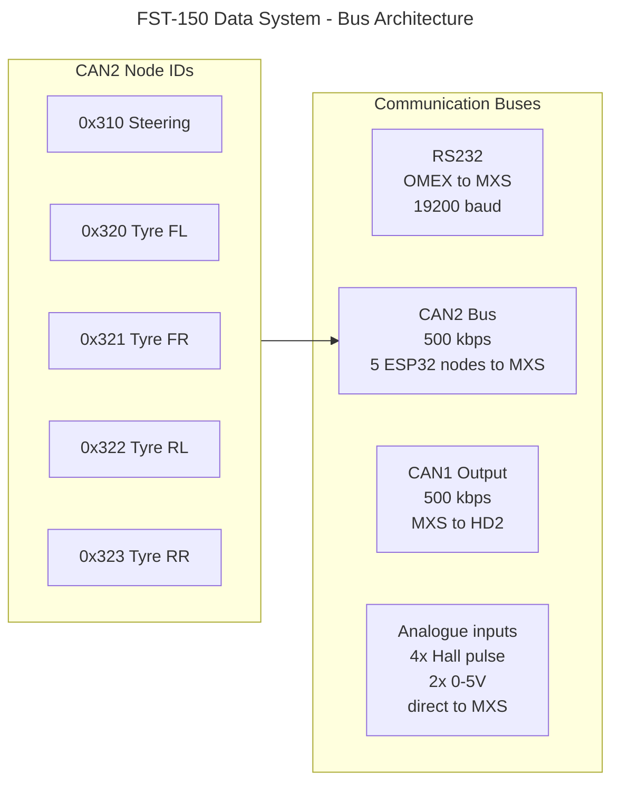

# FST-150 Data System - Architecture

## Overview

The FST-150 data system is a distributed CAN bus network with the AiM MXS 1.2 dash logger acting as the central hub. Custom ESP32 sensor nodes broadcast sensor data on CAN2. The MXS consolidates this with ECU, GPS, and analogue channels, then rebroadcasts a consolidated stream on CAN1 to the VBOX HD2 video logger for overlay.

## Topology

Three separate communication buses meeting at the MXS:

1. RS232 - OMEX 600 ECU to MXS ECU Stream input, 19200 baud
2. CAN2 - Custom ESP32 sensor nodes to MXS CAN2 Stream input, 500 kbit/s
3. CAN1 - MXS CAN Output to VBOX HD2, 500 kbit/s

Plus native MXS analogue inputs for wheel speeds (Hall) and brake pressures (0-5V from Variohm sensors).

## Bus architecture

## CAN ID scheme

- 0x300-0x30F reserved for future chassis sensors
- 0x310 steering angle node
- 0x320-0x323 tyre temperature summary messages (FL, FR, RL, RR)
- 0x330-0x33F reserved for future expansion
- 0x500-0x5FF reserved for MXS to HD2 CAN Output messages

## Data model

### Per-corner tyre temperature summary (10 Hz)

CAN IDs 0x320 to 0x323 (one per corner):

| Bytes | Signal | Scale | Range |
|-------|--------|-------|-------|
| 0-1 | Inner band average | 0.1 degC | -40 to +300 |
| 2-3 | Middle band average | 0.1 degC | -40 to +300 |
| 4-5 | Outer band average | 0.1 degC | -40 to +300 |
| 6-7 | Overall average | 0.1 degC | -40 to +300 |

All values uint16 big-endian (Motorola).

### Steering angle (100 Hz)

CAN ID 0x310:

| Bytes | Signal | Scale | Range |
|-------|--------|-------|-------|
| 0-1 | Angle | 0.1 deg | -450 to +450 |
| 2 | Rolling counter | 1 | 0 to 255 |
| 3 | Status byte | bit-packed | see below |

Status byte bits:
- Bit 0: sensor OK
- Bit 1: calibration valid
- Bit 2: magnet detected
- Bits 3-7: reserved

### Future: full thermal map (1 Hz per corner)

For post-session analysis. Multi-frame protocol on CAN IDs 0x340 to 0x343.

## Failure isolation

Each ESP32 node has:
- Its own power regulator
- Its own CAN transceiver
- A rolling counter in every CAN frame
- A status byte indicating health

A failed node manifests as a stale rolling counter, which the MXS can detect via a math channel and raise a warning without stopping the rest of the system.

## Existing configuration

The MXS 1.2 already has a working configuration with:
- OMEX 600 on RS232 ECU stream (GEMS - OMEX 600 710 v02.00.00)
- CAN Output on CAN1 at 500 kbit/s with messages 0x44, 0x45, 0x46, 0x647
- OMEX channels enabled: RPM, TPS, ECT, IAT, MAP, battery voltage, injection PW, spark advance
- GPS internal

Extensions needed:
- Configure CAN2 Stream to receive ESP32 messages 0x310, 0x320-0x323
- Extend CAN Output to include tyre and steering channels
- Migrate brake pressures from MIM to MXS analogue inputs
- Add wheel speed inputs on 22-pin harness
- Add math channels for temperature deltas and warnings
